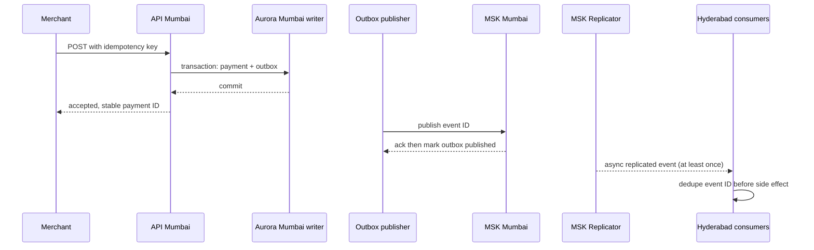
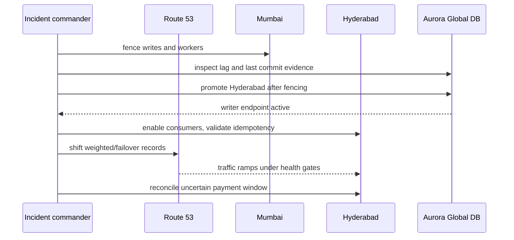
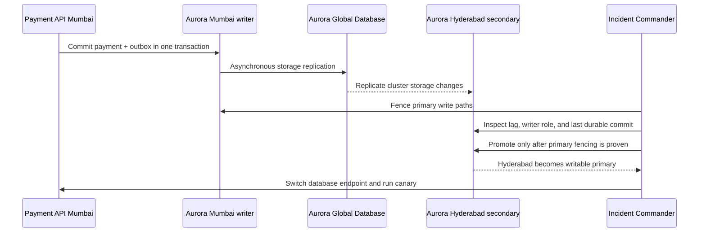
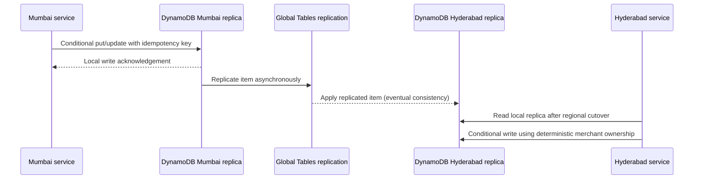
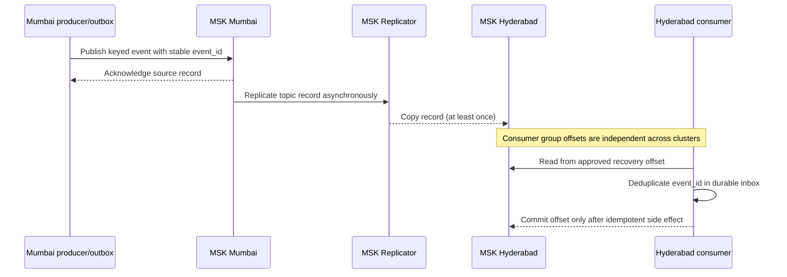
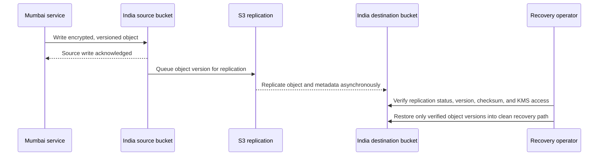

# Replication and cutover sequence diagrams

## Normal write and asynchronous replication



## Region failover



## Aurora PostgreSQL cross-region replication and promotion



## DynamoDB Global Tables replication



Use Global Tables only for operational metadata in this design. Concurrent same-item writes can resolve with last-writer-wins semantics; never use the table as the authoritative payment ledger or assume a write acknowledged in one region is immediately readable in another.

## ElastiCache Redis Global Datastore recovery

```mermaid
sequenceDiagram
 participant API as Mumbai cache client
 participant P as Redis primary
 participant GD as Global Datastore replication
 participant S as Hyderabad secondary
 participant IC as Incident Commander
 API->>P: Cache lookup or rebuildable session data
 P->>GD: Asynchronous replication
 GD-->>S: Replicate cache state
 IC->>S: Check replication lag and primary isolation
 IC->>S: Promote secondary after database authority decision
 S-->>IC: Hyderabad cache becomes writable
 IC->>API: Reconnect; tolerate misses and rebuild from durable stores
```

Redis is a cache/session optimization only. Never use it as the sole copy of balance, idempotency, payment status, or transaction ownership. Cache loss is recovered from durable systems; expired or absent keys are normal during promotion.

## Kafka MSK Replicator recovery



Replicator does not provide atomic cross-region producer acknowledgement or consumer offset transfer. Define the replay point from durable outbox/inbox/event IDs and reconcile the ambiguous window. Never skip an offset merely to make lag appear green.

## S3 cross-region replication



Ordinary S3 CRR is asynchronous. If a contractual replication-time objective is required, validate eligibility and configure S3 Replication Time Control separately; do not describe RTC timing as a default CRR guarantee. Keep both buckets and KMS keys in approved India regions.

## Split-brain authority and fencing

```mermaid
sequenceDiagram
 participant M as Mumbai writer
 participant H as Hyderabad secondary
 participant W as Independent fencing witness
 participant IC as Incident Commander
 IC->>M: Observe writer role and commit position
 IC->>H: Observe role, lag, and local write state
 Note over M,H: Inter-region partition; both local health checks may pass
 IC->>W: Verify out-of-band authority and fencing path
 alt Mumbai can be conclusively fenced
  IC->>M: Fence writes and credentials
  IC->>H: Promote only after fence verification
 else Fence cannot be proven
  IC->>M: Keep writes disabled/queued where reachable
  IC->>H: Do not promote; escalate and preserve single-writer safety
 end
```

DynamoDB MREC, Redis Global Datastore, Kafka Replicator, and S3 CRR all copy asynchronously and independently. There is no distributed atomic commit across these services. Treat each as a recoverable projection; reconcile from authoritative Aurora plus rail settlement records. Set measured lag SLOs per stream and alert before 60 seconds; do not assume service default replication timing guarantees the business RPO.
