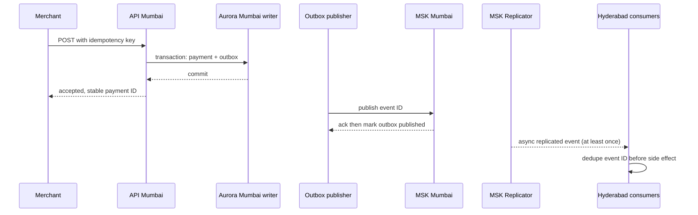
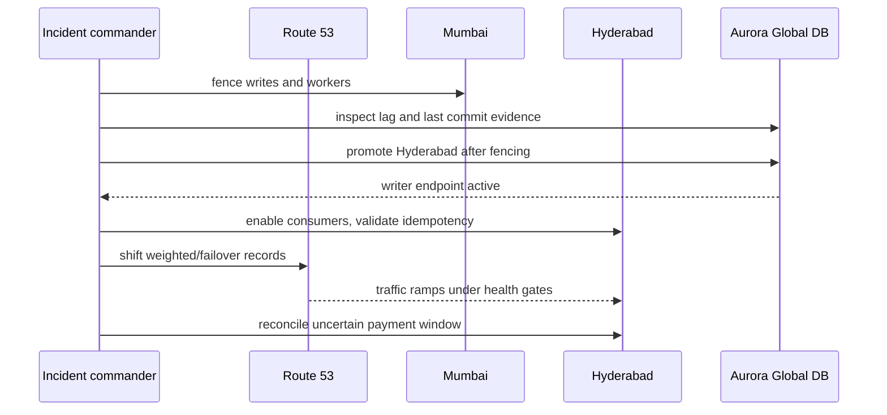

# Replication and cutover sequence diagrams

## Normal write and asynchronous replication

## Region failover

DynamoDB MREC, Redis Global Datastore, Kafka Replicator, and S3 CRR all copy asynchronously and independently. There is no distributed atomic commit across these services. Treat each as a recoverable projection; reconcile from authoritative Aurora plus rail settlement records. Set measured lag SLOs per stream and alert before 60 seconds; do not assume service default replication timing guarantees the business RPO.
